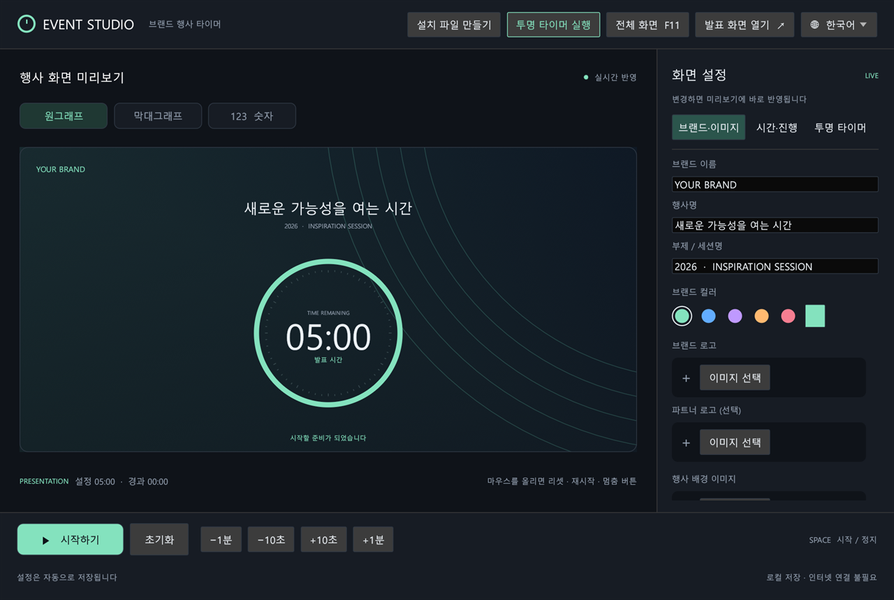
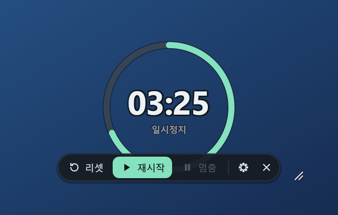
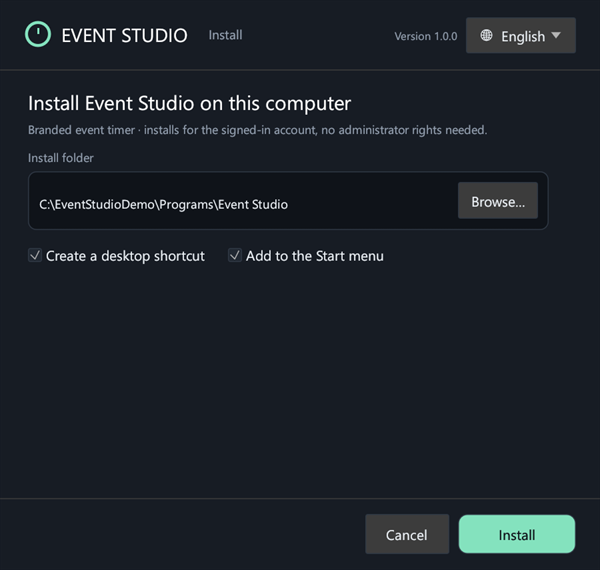
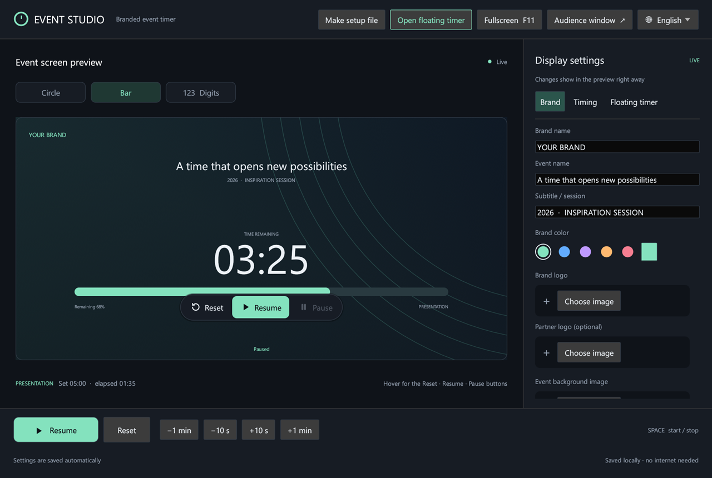

# Event Studio

행사와 발표를 위한 **브랜드 타이머**입니다 (Windows · macOS). 브랜드 이름, 행사명, 로고와 배경 이미지를 넣고
원그래프 · 막대그래프 · 숫자 중에서 골라 쓰며, 발표 자료 위에 배경 없이 떠 있는 **투명 타이머**로도 쓸 수 있습니다.

A **branded timer for events and presentations** on Windows and macOS, written in Rust with [egui](https://github.com/emilk/egui).
[English summary below](#english).



## 주요 기능

- **세 가지 표시**: 원그래프, 막대그래프, 숫자. 진행 중에 바꿔도 시간은 그대로입니다.
- **브랜드 화면**: 브랜드 이름, 행사명, 부제, 브랜드 색, 로고 두 개, 배경 이미지.
  어두운 화면에서 잘 안 보이는 어두운 로고는 저절로 흰색으로 나옵니다 (로고 색: 자동 · 원래 색 · 흰색).
- **투명 타이머**: 배경 없이 모든 창 위에 떠 있고, 마우스를 올리면 리셋 · 재시작 · 멈춤 버튼이 나옵니다.
  빈 곳을 누르면 뒤에 있는 발표 자료가 눌리고, 버튼을 눌러도 발표 프로그램의 키보드 입력을 가져가지 않습니다.
- **출력 화면**: 프로젝터나 다른 모니터로 옮길 수 있는 별도 창을 최대 6개까지 열고, 화면마다 형식을 고릅니다
  (메인과 같게 · 원그래프 · 막대그래프 · 숫자 · 발표자용 · 작게). 모든 화면은 하나의 시계를 같이 보므로
  시작 · 멈춤 · 시간 조절이 지연 없이 한꺼번에 반영되고, 새로 연 화면도 곧바로 지금 상태로 나옵니다.
  화면을 오른쪽 클릭하면 형식 · 전체 화면 · 닫기 메뉴가 나오고, 열어 둔 화면을 다음 실행 때 다시 열 수도 있습니다.
- **진행**: 발표 → Q&A 전환(자동 · 수동, 남은 시간 이월), 종료 전 경고, 종료 알림음, 초과 시간, 카운트업.
- **단축키**: 창 안에서는 Space(시작 / 정지) · R · Q · ↑↓(±1분) · ←→(±10초) · [ ] (시간 프리셋) · 1/2/3 · F11 · N(새 출력 화면).
  편집 화면의 "단축키" 탭에서 키를 직접 눌러 바꾸고, 하나씩 지우고, 기본값으로 되돌리고, 전체를 끌 수 있습니다.
  같은 키를 두 동작에 주면 먼저 쓰던 동작에서 가져오고, 입력 칸에 글을 쓰는 동안과 시스템이 쓰는 키(Ctrl+C, Alt+F4 등)는 지정되지 않습니다.
  다른 프로그램을 보고 있을 때는 전역 단축키(Ctrl+Alt+Space / R / Q, 투명 타이머가 떠 있을 때는 Ctrl+1 / 2 / 3)를 씁니다.
- **언어**: 한국어 · English · 中文(简体) · 日本語. 오른쪽 위 언어 상자에서 바로 바뀝니다.
- **설치 파일 만들기**: 프로그램이 지금 설정과 이미지를 담아 스스로 설치 파일이 됩니다.
  관리자 권한 없이 사용자 계정에 설치되고, Windows 설정의 앱 목록에서 제거할 수 있습니다.
- 설정은 프로그램 옆의 `settings.json`에만 저장되며 인터넷 연결을 쓰지 않습니다.
  `settings.json`을 읽을 수 없으면 직전 설정(`settings.backup.json`)으로 열고, 시작하지 못하거나 오류로 끝나면
  안내 창을 띄우고 `error-log.txt`에 기록합니다.

| 투명 타이머 | 설치 창 |
|---|---|
|  |  |

버전별로 바뀐 내용은 [CHANGELOG.md](CHANGELOG.md)에 있습니다.

자세한 사용법은 [사용안내.txt](사용안내.txt) · [Guide.txt](Guide.txt) · [使用说明.txt](使用说明.txt) · [使い方.txt](使い方.txt)에 있습니다.

## 내려받기

[Releases](../../releases/latest)에서 **EventStudio-<버전>-Setup.exe**를 받아 실행하고 "설치"를 누르세요
(관리자 권한 · 인터넷 연결 불필요). 설치하지 않고 쓰려면 **EventStudio-<버전>.exe**를 그대로 실행해도 됩니다.
서명하지 않은 프로그램이라 Windows가 "Windows의 PC 보호" 창을 띄우면 "추가 정보" → "실행"을 누르세요.

**macOS**: **EventStudio-<버전>-macOS.dmg**를 열고 Event Studio를 "응용 프로그램" 폴더로 끌어 넣으세요.
Apple Developer ID로 서명하지 않은 앱이라 처음 열 때 macOS가 막으면, 시스템 설정 → 개인정보 보호 및 보안에서
"그래도 열기"를 누르세요. ([macOS에서 다른 점](#macos에서-다른-점))

## 직접 빌드하기

[Rust](https://www.rust-lang.org/tools/install)(stable)가 있으면 아래처럼 직접 만들 수 있습니다.

```
cargo build --release
cargo test
```

- 결과물은 `target\release\event-studio.exe` 하나입니다. 이름을 `EventStudio.exe`로 바꿔 아무 폴더에나 두고 실행하면 됩니다.
- `x86_64-pc-windows-gnu` 툴체인(rustc 1.99, llvm-mingw 링커)으로 빌드하고 테스트했습니다. MSVC 툴체인으로는 확인하지 않았습니다.
- 프로그램 파일의 아이콘과 버전 정보는 툴체인에 `windres`가 있을 때만 들어갑니다. 없으면 경고만 나오고 빌드는 됩니다.
- 한국어 · 중국어 · 일본어 글자는 Windows에 들어 있는 글꼴(맑은 고딕, Microsoft YaHei, Yu Gothic)로 그립니다.
- 테스트는 임시 폴더와 `checks\` 아래에 작은 파일을 만들고, 레지스트리는 테스트용 임시 키만 만들었다가 지웁니다.
- macOS에서는 `packaging/macos/bundle.sh`가 `Event Studio.app`(Apple Silicon + Intel)과 `.dmg`를 `dist/macos`에 만듭니다.
- 풀 리퀘스트와 `main`에 올라온 변경은 GitHub Actions(`.github/workflows/ci.yml`)가 Windows와 macOS에서 빌드하고 테스트합니다.
  소스는 `cargo fmt`(`rustfmt.toml`)로 서식을 맞추고 `cargo clippy --all-targets -- -D warnings`를 통과해야 합니다.

## macOS에서 다른 점

- 설정, 이미지, `error-log.txt`는 앱 옆이 아니라 `~/Library/Application Support/Event Studio`에 저장됩니다.
- 단축키의 Ctrl은 Control 키, Alt는 Option 키입니다. 전체 화면은 Control+Command+F로도 바꿉니다.
- 투명 타이머를 누르면 Event Studio가 잠깐 앞으로 나왔다가, 마우스 버튼을 떼면 그 전에 쓰던 프로그램(발표 프로그램)에
  키보드를 돌려줍니다. 떠 있는 동안에도 Dock에는 Event Studio가 보입니다.
- "설치 파일 만들기"는 Windows에만 있습니다. 다른 Mac에는 앱을 그대로 복사하면 됩니다.
- macOS 빌드는 GitHub Actions의 macOS에서 빌드하고 자동 테스트를 돌린 것입니다. 실제 Mac 화면에서 투명 타이머가
  발표 화면 위에 뜨는 모습, 빈 곳 클릭 통과, 전역 단축키는 사람이 아직 확인하지 않았습니다.

## 명령줄 옵션

| 옵션 | 하는 일 |
|---|---|
| `--overlay` | 투명 타이머로 바로 시작 |
| `--lang ko\|en\|zh\|ja` | 저장된 언어와 상관없이 그 언어로 시작 |
| `--make-setup <파일>` | 지금 설정과 이미지를 담은 설치 파일 만들기 (`--no-settings`: 설정 없이) |
| `--install`, `--uninstall` | 설치 창 · 제거 창 열기 (`--silent`: 창 없이, `--dir <폴더>`, `--no-desktop`, `--no-start-menu`, `--replace-settings`, `--remove-data`, `--log <파일>`) |
| `--sandbox <폴더>` | 시작 메뉴 · 바탕 화면 · 앱 목록 항목까지 모두 그 폴더 안에만 만들기 (점검용) |
| `--screenshot <파일.png>` | 창을 그려 PNG로 저장하고 끝내기 (`--demo`로 점검용 화면 상태 지정) |
| `--write-icon <파일.png>` | 프로그램 아이콘을 1024픽셀 PNG로 저장하고 끝내기 (macOS 앱을 묶을 때 씀) |

`checks\` 폴더의 PowerShell 7(`pwsh`) 스크립트는 빌드한 프로그램을 임시 폴더 안에서만 설치 · 실행 · 제거해 보고,
네 언어의 모든 화면을 그려 봅니다.

## 소스 구성

| 파일 | 내용 |
|---|---|
| `src/timer.rs` | 시간 계산: 시작 · 멈춤, 경고 · 종료 · 초과, Q&A 전환 |
| `src/studio.rs` | 편집 화면, 설정 저장, 발표 화면, 투명 타이머로 전환 |
| `src/screens.rs`, `src/shortcuts.rs` | 출력 화면(형식 · 그리기)과 단축키(동작 · 키 지정 · 충돌 · 키 입력 처리) |
| `src/scene.rs`, `src/overlay.rs`, `src/controls.rs` | 발표 화면, 투명 타이머, 마우스를 올리면 나오는 버튼 |
| `src/win.rs`, `src/win_mac.rs` | 창 처리: 항상 위, 클릭 통과, 전역 단축키 (Windows, macOS) |
| `src/lang.rs`, `src/strings.rs` | 네 언어의 문구 표와 언어 전환 |
| `src/pack.rs`, `src/setup.rs`, `src/setup_ui.rs`, `src/shell.rs` | 설치 파일 형식, 설치 · 제거, 설치 창, 바로 가기와 앱 목록 |
| `src/icon_art.rs`, `build.rs` | 프로그램 아이콘 그리기와 버전 정보 |
| `src/report.rs` | 시작하지 못했거나 오류로 끝날 때의 안내 창과 `error-log.txt` 기록 |
| `packaging/macos/` | macOS 앱(`Event Studio.app`)과 `.dmg` 묶기 |

영어 · 중국어 · 일본어 문구는 원어민 검수를 거치지 않았습니다. 어색한 표현은 `src/strings.rs`의 해당 줄을 고쳐 보내 주시면 됩니다.

## 만든 곳과 라이선스

벤처스퀘어의 행사용 발표 타이머 VS Event Timer의 뒤를 잇는 프로그램으로, Rust와 egui로 새로 만들었습니다.

[MIT 라이선스](LICENSE)로 공개합니다. 함께 쓰인 오픈소스 라이브러리와 글꼴의 목록은
[THIRD-PARTY-NOTICES.md](THIRD-PARTY-NOTICES.md)에, 라이선스 전문은 [THIRD-PARTY-LICENSES.txt](THIRD-PARTY-LICENSES.txt)에
있습니다. 전문은 설치본과 macOS 앱에 함께 들어가고, 편집 화면 아래의 "오픈소스 라이선스"로 열 수 있습니다.

---

## English

Event Studio is a timer for events and presentations that carries your brand: brand name, event
name, subtitle, brand colour, two logos and a background image, shown as a circle, a bar or plain
digits. A dark logo that would be hard to see on the dark stage is shown in white by itself
(Logo color: Auto · Original · White).



- **Floating timer**: no background, always on top of your slides. Hover for Reset · Resume · Pause;
  clicks on empty spots go to the window behind, and pressing the buttons never takes the keyboard
  away from the slide show.
- **Output screens**: up to six extra windows for projectors and other monitors, each in a format of
  its own (as the editor · circle · bar · number · presenter view · compact). All of them read one
  clock, so start, pause and time changes reach every screen at once, and a screen opened late shows
  the current state in its first frame. Right-click a screen for its format, full screen and close;
  the open screens can come back at the next start.
- **Running an event**: presentation → Q&A (automatic or by hand, unused time can carry over), a
  warning before the end, an end sound, overtime and count-up.
- **Keyboard shortcuts** in the windows: Space (start / pause), R, Q, ↑↓ (±1 min), ←→ (±10 s), [ ] (time
  presets), 1/2/3, F11, N (new output screen). The "Shortcuts" tab records a new key from the keyboard,
  clears one, goes back to the defaults, or switches all of them off. A key given to a second action is
  taken from the first; nothing fires while a text box has the keyboard, and keys the system uses
  (Ctrl+C, Alt+F4 …) cannot be given. System-wide hotkeys (Ctrl+Alt+Space / R / Q; Ctrl+1 / 2 / 3 while
  the floating timer is up) are separate.
- **Languages**: 한국어, English, 中文 (Simplified), 日本語, switched from the box at the top right.
- **Its own setup file**: "Make setup file" packs the program with your current settings and
  images. It installs per user without administrator rights and can be removed from Windows'
  list of installed apps.
- Settings live in `settings.json` beside the program; nothing is sent anywhere.
  If `settings.json` cannot be read the previous settings (`settings.backup.json`) are used; a start
  that fails or a fault that ends the program is shown in a message box and written to `error-log.txt`.

Guides: [Guide.txt](Guide.txt) (English), [사용안내.txt](사용안내.txt), [使用说明.txt](使用说明.txt), [使い方.txt](使い方.txt).

### Download

Get **EventStudio-&lt;version&gt;-Setup.exe** from [Releases](../../releases/latest), run it and press
"Install" (no administrator rights or internet connection needed), or run **EventStudio-&lt;version&gt;.exe**
without installing. The program is not code-signed, so Windows may show "Windows protected your
PC": choose "More info", then "Run anyway".

On **macOS**, open **EventStudio-&lt;version&gt;-macOS.dmg** and drag Event Studio to Applications. The app
is not signed with an Apple Developer ID, so the first time macOS may refuse to open it: allow it
with "Open Anyway" in System Settings → Privacy & Security.

### Building

With [Rust](https://www.rust-lang.org/tools/install) (stable):

```
cargo build --release
cargo test
```

The result is the single file `target\release\event-studio.exe`; rename it to `EventStudio.exe`
and run it from any folder. It is built and tested with the `x86_64-pc-windows-gnu` toolchain
(rustc 1.99, llvm-mingw linker); the MSVC toolchain has not been tried. The program file gets its
icon and version details only when the toolchain has `windres`; without it the build warns and
goes on. The command-line options and the source layout are listed in the Korean part above.

On a Mac, `packaging/macos/bundle.sh` builds `Event Studio.app` (Apple Silicon + Intel) and a `.dmg`
in `dist/macos`. Every pull request is built and tested on Windows and macOS by GitHub Actions
(`.github/workflows/ci.yml`); the source has to be laid out by `cargo fmt` and pass
`cargo clippy --all-targets -- -D warnings`.

### On macOS

- Settings, images and `error-log.txt` are kept in `~/Library/Application Support/Event Studio`,
  not beside the app.
- Ctrl in the hotkeys is the Control key and Alt the Option key; Control+Command+F also switches
  full screen.
- A click on the floating timer brings Event Studio forward for a moment; when the mouse button
  is up, the program that was in front (the slide show) gets the keyboard back. Event Studio stays
  in the Dock while the timer floats.
- "Make setup file" is for Windows only; an app is copied to another Mac as it is.
- The macOS build is built and tested by GitHub Actions on macOS. How the floating timer looks
  over a slide show on a real Mac screen, clicks passing through its empty parts and the global
  hotkeys have not yet been checked by a person.

The English, Chinese and Japanese wording has not been reviewed by native speakers; corrections
to `src/strings.rs` are welcome.

### Licence

[MIT](LICENSE). Event Studio follows VS Event Timer, VentureSquare's presentation timer for its
own events, and was written anew in Rust with egui. The open-source libraries and fonts it is built
with are listed in [THIRD-PARTY-NOTICES.md](THIRD-PARTY-NOTICES.md), and their licences are in
[THIRD-PARTY-LICENSES.txt](THIRD-PARTY-LICENSES.txt), which goes with every copy of the program.
